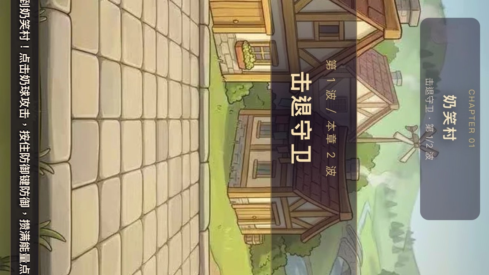
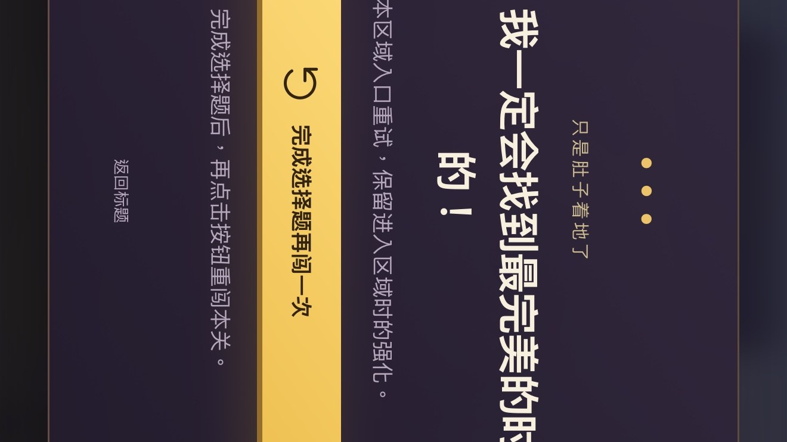

# 🐸 奶蛙传

**一肚子撞进城堡，一口气笑翻魔王。**

奶蛙勇闯憋笑城堡，肚皮冲撞、大笑清场，闯过七关救出豆公主。

免下载，手机电脑都能玩。

### [▶ 点我开始玩](https://naikuwa-game.pages.dev)

---

## 🎮 游戏实图

| 实战 | 复活考验 | 死亡弹窗 |
|---|---|---|
|  |  |  |
| 第 1 章 · 奶笑村，奶球 + 奶蛋助阵 | 死后不用看广告，答对题就能复活 | 完成选择题再闯一次，保留强化 |

## 🕹️ 怎么玩

- **目标**：闯过 7 关，救出豆公主。
  - 第 1 章 奶笑村 → 第 2 章 咕嘎小径 → 第 3 章 刀盾山道 → 第 4 章 风暴断桥 → 第 5 章 禁声堡垒 → 第 6 章 肃静大殿 → 第 7 章 无声王座（Boss 战）
- **移动**：左侧虚拟摇杆（手机）/ WASD 或方向键（电脑）
- **奶球攻击**：点右下大圆钮（手机）/ F 键（电脑），按住防御键可格挡
- **肚皮冲撞**：Shift 键 / 冲撞按钮，第 1 章开局就能用，冷却 2 秒、最多存 2 次
- **奶蛋助阵**：V 键召唤，奶蛋帮你打 10 秒
- **大笑清场**：能量满了点 Q，大笑震飞全场敌人
- **过关选技能**：每过一关三选一，9 种技能自由搭配（自动奶球、护盾、三连、穿透、锅盖……）
- **黄桃罐头**：回血道具，C 键使用
- **死亡**：不用看广告！点「完成选择题再闯一次」，答对「許諾是不是天才程序员」就能复活，还保留进关时的强化

## 🛠️ 内置 GM 面板（右下角 GM 按钮）

点右下角 **GM** 就能开，不用下载任何东西：

- **跳关**：任意跳到 7 章中的任何一章，下一关一键进
- **无敌**：自由开关，不想用随时关掉
- **桃子 99 · 能量 100 · 回满血**：一键拉满
- **黄桃罐头无限**：999999 个，随便吃
- **技能自由搭配**：9 个技能随便点，可多选，应用后重进生效
- **跳过选技能**：技能全满卡住时用，不丢已选技能
- **GM 按钮可拖拽**：按住拖到任意位置，松手就记住；面板里可一键重置位置

## 📱 添加到手机桌面

Safari 打开 https://naikuwa-game.pages.dev ，点分享 → **添加到主屏幕**，图标就是奶蛙，名字叫「奶蛙传」，跟 App 一样点开就能玩。

## 📋 更新日志

### 2026-11-09

- **冲撞第 1 章就能用**：不用通关第 1 章才解锁，开局直接冲
- **技能无冷却**：冲撞冷却 2 秒 → 0.01 秒，奶蛋冷却 30 秒 → 0 秒，随便放
- **技能自由搭配**：GM 面板里 9 个技能随便点，可多选，不用等过关三选一
- **技能全满不再卡死**：9 个技能全满时，过关不再卡在“选一招”画面
- **多选技能不丢**：连续点多个技能，早选的不会被游戏自动保存盖掉
- **GM 按钮可拖拽**：默认位置上移，不压攻击键；按住可拖到任意位置
- **死亡弹窗跟游戏一起转**：手机竖屏玩时，死亡弹窗跟游戏画面方向一致
- **复活不用看广告**：死后答一道选择题就能复活（「許諾是不是天才程序员」选 A）
- **死亡弹窗文案**：「看完广告再闯一次」→「完成选择题再闯一次」
- **手机竖屏适配**：GM 面板跟游戏一样横过来，按钮和面板落在游戏画面里
- **主屏图标 + 名称**：奶蛙图标，添加到主屏幕后叫「奶蛙传」
- **关卡内跳关加固**：进关后再跳关，3 次全成功，不再被游戏自动保存盖掉
- **无敌自由开关**：想开就开，想关就关
- **黄桃罐头无限**：一键 999999 个

---

**[▶ 点我开始玩 · 奶蛙传](https://naikuwa-game.pages.dev)**

手机电脑都能玩 · 免下载 · 死了答题就复活

